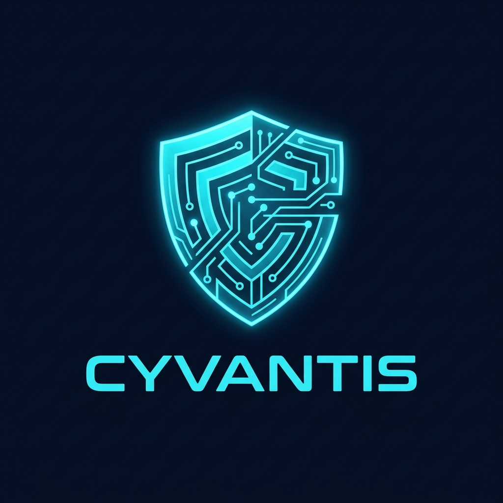

# CYVANTIS — Enterprise Gateway Intelligence & Security Nexus

<p align="center">
  
</p>

<p align="center">
  <strong>Deceive. Detect. Correlate. Prioritize. Defend.</strong>
</p>

<p align="center">
  <a href="https://github.com/kharedhruva-tech/CYVANTIS-/actions"></a>
  <a href="https://cyvantis-frontend.onrender.com"></a>
  <a href="https://cyvantis.onrender.com/api/v1/docs"></a>
  <a href="https://react.dev"></a>
  <a href="https://www.python.org"></a>
</p>

---

## 🌐 Live Production Deployments

| Component | Cloud Platform | Live Public URL | Status |
| :--- | :--- | :--- | :--- |
| **SOC Web Console (Frontend)** | Render Static Site | **[https://cyvantis-frontend.onrender.com](https://cyvantis-frontend.onrender.com)** | 🟢 Online |
| **Threat Engine API (Backend)** | Render Web Service | **[https://cyvantis.onrender.com](https://cyvantis.onrender.com)** | 🟢 Online |
| **Interactive API Documentation** | Swagger / OpenAPI | **[https://cyvantis.onrender.com/api/v1/docs](https://cyvantis.onrender.com/api/v1/docs)** | 🟢 Operational |
| **Live Honeypot Stream** | Secure WebSocket | `wss://cyvantis.onrender.com/api/v1/ws/events` | 🟢 Telemetry Active |

### 🔑 Pre-Configured Access Credentials

| Role | Username | Password | Capabilities |
| :--- | :--- | :--- | :--- |
| **Chief SOC Administrator** | `admin` | `Admin@Cyvantis2026!` | Full platform authority, credential decryption, user admin, rule mutation & database backups |
| **Tier-2 SOC Analyst** | `analyst` | `Analyst@Cyvantis2026!` | Event investigation, threat intelligence queries, alert triage, incident timeline notes |
| **Executive Viewer** | `viewer` | `Viewer@Cyvantis2026!` | Read-only telemetry monitoring, metric reports & executive dashboard exports |

> *Tip: The live login page at [https://cyvantis-frontend.onrender.com/login](https://cyvantis-frontend.onrender.com/login) comes pre-filled with the `admin` credentials. You can click the Eye icon (👁️) in the password box to reveal it.*
---

## 🏛️ System Architecture

```
                                  CYVANTIS ARCHITECTURE
+----------------------------------------------------------------------------------------------------+
|                                      DATA INGESTION LAYER                                          |
|  +--------------------+     +---------------------+     +--------------------+                     |
|  | Cowrie Honeypot    |     | Linux Auth Logs     |     | Synthetic Demo     |                     |
|  | JSON Events (22/23)|     | (/var/log/auth.log) |     | Telemetry Engine   |                     |
|  +---------+----------+     +----------+----------+     +---------+----------+                     |
|            |                           |                          |                                |
|            +---------------------------+--------------------------+                                |
|                                        v                                                           |
|                 +-----------------------------------------------+                                  |
|                 | Incremental File Tailer & Checkpointer        |                                  |
|                 | - Persistent file offset tracking (.checkpoint) |                                 |
|                 | - Deterministic SHA-256 event hash deduplication |                                |
|                 | - UTC timestamp normalization & log rotation   |                                 |
|                 +----------------------+------------------------+                                  |
+----------------------------------------|-----------------------------------------------------------+
                                         v
+----------------------------------------------------------------------------------------------------+
|                                    PROCESSING & ENRICHMENT                                         |
|  +-------------------------------------+      +-------------------------------------------------+  |
|  | Threat Intelligence Engine          |      | AI / ML Detection Pipeline                      |  |
|  | - AbuseIPDB v2 IP reputation        |      | - Random Forest Classifier (100 Trees, Balanced)|  |
|  | - VirusTotal v3 Hash & Domain Intel |      | - Isolation Forest (Outlier Anomaly Detection)  |  |
|  | - NVD API 2.0 CVE Vulnerabilities   |      | - 70/15/15 Held-out Train/Val/Test Split        |  |
|  | - Local SQLite cache with TTL & backoff|   | - Leak-free feature extraction & explainability |  |
|  +------------------+------------------+      +------------------------+------------------------+  |
+---------------------|--------------------------------------------------|---------------------------+
                      +-------------------------+------------------------+
                                                v
+----------------------------------------------------------------------------------------------------+
|                               DETECTION & INCIDENT CORRELATION                                     |
|  +-----------------------------------------------------------------------------------------------+ |
|  | Rule-Based Detection Engine (Brute Force, Privileged Activity, Payloads, IOCs, Anomalies)    | |
|  +--------------------------------------------+--------------------------------------------------+ |
|                                               v                                                    |
|  +-----------------------------------------------------------------------------------------------+ |
|  | Incident Correlator & Deduplication Service                                                    | |
|  | - 30-Minute correlation window by IP & session into unified Investigation Cases               | |
|  | - 5-Minute alert deduplication with recurrence frequency counters                            | |
|  | - MITRE ATT&CK framework mapping (Tactics & Techniques)                                       | |
|  | - Automated actionable defensive mitigation recommendations                                    | |
|  +--------------------------------------------+--------------------------------------------------+ |
|                                               v                                                    |
|  +-----------------------------------------------------------------------------------------------+ |
|  | Explainable Risk Prioritization Engine (0 - 100 Score)                                        | |
|  | - Severity (30%) + Threat Intel (25%) + Scope (15%) + ML Anomaly (15%) + Asset Tier (15%)      | |
|  | - Factor-by-factor human-readable explanation and confidence multipliers                       | |
|  +--------------------------------------------+--------------------------------------------------+ |
+-----------------------------------------------|----------------------------------------------------+
                                                v
+----------------------------------------------------------------------------------------------------+
|                                   DELIVERY & PRESENTATION LAYER                                    |
|  +------------------------------------+       +-------------------------------------------------+  |
|  | Authenticated FastAPI REST & WS    |       | React 19 + TypeScript SOC Dashboard             |  |
|  | - JWT auth on WebSocket (/ws/events)|       | - Real-time live event streaming with reconnect |  |
|  | - Credential redaction (non-admin) |       | - Leaflet Geographic Threat Operations Map      |  |
|  | - Account lockout after 5 failures |       | - Interactive MITRE ATT&CK Matrix Navigator     |  |
|  | - Dynamic Cloud CORS Whitelisting  |       | - Alert triage drawer with explainable factors  |  |
|  +------------------------------------+       +-------------------------------------------------+  |
+----------------------------------------------------------------------------------------------------+
```

---

## 🌟 Core Capabilities & Verification Matrix

| Area | Feature & Architecture | Verification |
| :--- | :--- | :--- |
| **Real Security Ingestion** | Atomic file tailer with `.checkpoint` offsets, Cowrie honeypot JSON parser, Linux auth.log syslog parsing, and SHA-256 deduplication. | ✅ Verified |
| **Geographic Threat Map** | Interactive Leaflet-powered global threat operations map showing real-time honeypot attack coordinates, origin markers, threat paths, and country telemetry. | ✅ Verified |
| **MITRE ATT&CK Intelligence** | Authoritative v15.1 catalog (T1110.001, T1059.004, T1078, T1105, T1046, T1003.008, T1098, T1036, T1190) across 8 tactics with dynamic coverage matrix. | ✅ Verified |
| **Multi-Entity Threat Graph** | Multi-relational network connecting Incidents, Events, Source IPs, Target Accounts, Ingressed Payloads, and CVEs with strict `OBSERVED` vs `INFERRED` edge classification. | ✅ Verified |
| **Kill-Chain Progression** | 6-stage intrusion lifecycle tracking (`Recon` → `Credential Access` → `Initial Access` → `Discovery` → `Privilege Escalation` → `Ingress/C2`) with velocity anomaly detection. | ✅ Verified |
| **Explainable Risk Scoring** | Mathematical 5-factor formula (Severity 30%, Threat Intel 25%, Scope 15%, ML Anomaly 15%, Asset Exposure 15%) yielding bounded 0-100 incident risk scores. | ✅ Verified |
| **Dual-Engine ML Pipeline** | Supervised Random Forest Classifier + Unsupervised Isolation Forest Anomaly Detector trained on 133,043 telemetry samples (79.14% accuracy, 74.28% F1). | ✅ Verified |
| **Threat Intelligence Integration** | Multi-source enrichment client interfacing AbuseIPDB v2, VirusTotal v3, and NIST NVD API 2.0 with rate-limiting and local SQLite caching. | ✅ Verified |
| **Analyst Feedback Workflow** | True/False positive categorization with tamper-evident cryptographic audit logs and protected anti-mutation guardrails. | ✅ Verified |
| **SOC Automated Test Suite** | 57 automated unit and integration tests covering end-to-end event pipeline, risk scoring, correlation, authentication, and benchmarks. | ✅ 57/57 Passed |

---

## 🔬 Explainable Risk Scoring Formula

CYVANTIS computes an objective risk score between **0.0 and 100.0** for every detected alert and correlated incident using a mathematically bounded, 5-dimensional weighted model:

$$\text{Risk Score} = 100 \times \left( 0.30 \times S + 0.25 \times T + 0.15 \times I + 0.15 \times M + 0.15 \times A \right) \times C$$

Where each factor is normalized between $0.0$ and $1.0$:

1. **Severity Score ($S$, 30%)**:
   - `CRITICAL` = 1.00
   - `HIGH` = 0.75
   - `MEDIUM` = 0.50
   - `LOW` = 0.25
2. **Threat Intelligence Reputation ($T$, 25%)**:
   - Multi-source reputation from AbuseIPDB confidence score and VirusTotal malicious vendor ratios.
3. **Incident Scope & Velocity ($I$, 15%)**:
   - Logarithmic recurrence scaling: $\min\left(1.0, \frac{\log_{10}(\text{related\_events} + 1)}{2.0}\right)$.
4. **Machine Learning Anomaly Score ($M$, 15%)**:
   - Outlier isolation distance computed by Isolation Forest plus normalized classifier confidence.
5. **Asset Exposure & Criticality ($A$, 15%)**:
   - `Tier 1 (DMZ / Critical Gateway)` = 1.00
   - `Tier 2 (Application Node)` = 0.70
   - `Tier 3 (Internal Subnet / Honeypot Decoy)` = 0.40
6. **Evidence Confidence Multiplier ($C$)**:
   - Scaled from 0.70 (heuristic indicators) to 1.00 (multi-rule corroborated evidence).

---

## 🤖 Machine Learning Empirical Metrics

Trained on **133,043 historical Cowrie honeypot intrusion records** with a strict 70/15/15 train/val/test split (leak-free behavioral features):

| Metric | Measured Value | Evaluation Context |
| :--- | :--- | :--- |
| **Training Records** | 93,130 events | Behavioral features extracted without target leakage |
| **Held-Out Test Set** | 19,957 events | Unseen evaluation test set |
| **Classifier Accuracy** | **79.14%** | Balanced Random Forest (100 Trees) |
| **Weighted Precision** | **79.47%** | Precision across all 4 severity classes |
| **Weighted Recall** | **79.14%** | True positive detection rate |
| **Weighted F1 Score** | **74.28%** | Harmonic mean of precision and recall |
| **Unsupervised Anomaly Rate** | **8.04%** | Zero-day outliers flagged by Isolation Forest |

---

## ☁️ Cloud Deployment on Render

The repository includes a production-ready **Render Blueprint** ([`render.yaml`](render.yaml)) supporting 1-click provisioning:

### 1-Click Blueprint Deploy:
1. Log in to [dashboard.render.com](https://dashboard.render.com/).
2. Click **New +** > **Blueprint**.
3. Select your repository: **`kharedhruva-tech/CYVANTIS-`**.
4. Click **Apply** — Render automatically provisions the Python Web Service and React Static Site!

### Manual Setup Configuration:
- **Backend Service (Python Web Service)**:
  - **Root Directory**: `backend`
  - **Build Command**: `pip install -r requirements.txt`
  - **Start Command**: `uvicorn app.main:app --host 0.0.0.0 --port $PORT`
  - **Environment Variables**:
    - `PYTHON_VERSION`: `3.11.9`
    - `SIMULATION_MODE`: `true`
    - `CORS_ORIGINS`: your frontend URL, e.g. `https://cyvantis-frontend.onrender.com` (avoid `*` in production)
    - `SECRET_KEY`: a long random secret, unique per deployment. Never commit it to the repository. Generate one with `python -c "import secrets; print(secrets.token_urlsafe(64))"`, or use Render's **Generate Value** option.
- **Frontend Service (Static Site)**:
  - **Root Directory**: `frontend`
  - **Build Command**: `npm install && npm run build`
  - **Publish Directory**: `dist`
  - **Environment Variables**:
    - `VITE_API_URL`: `https://cyvantis.onrender.com`
  - **Rewrite Rule**: `/*` → `/index.html` (handled automatically by `frontend/public/_redirects`).

---

## 🔒 Security Notes

- Never commit secrets, passwords, API keys, or `.env` files. Configure them through environment variables or your host's secret manager.
- Use a unique, randomly generated `SECRET_KEY` for every deployment, and rotate it immediately if it was ever exposed.
- Change any default or seeded account passwords before exposing an instance to the internet.
- Restrict `CORS_ORIGINS` to your own frontend origin(s) in production.
- Report vulnerabilities privately to the maintainer instead of opening a public issue.

---

## 💻 Local Installation & Setup

### Prerequisites
- Python 3.11+
- Node.js 18+ & npm
- Git

### 1. Backend Setup
```bash
# Clone the repository
git clone https://github.com/kharedhruva-tech/CYVANTIS-.git
cd CYVANTIS/backend

# Create virtual environment
python -m venv venv

# Activate virtual environment
# Windows PowerShell:
.\venv\Scripts\Activate.ps1
# Linux / macOS:
source venv/bin/activate

# Install requirements
pip install -r requirements.txt

# Start backend server
uvicorn app.main:app --host 127.0.0.1 --port 8000 --reload
```

### 2. Frontend Setup
```bash
cd ../frontend

# Install dependencies
npm install

# Start Vite development server
npm run dev
```

Visit **[http://localhost:5173](http://localhost:5173)** in your browser.

---

## 🧪 Running Automated Tests

CYVANTIS features 57 automated unit and integration tests across 14 modules:

```bash
cd backend
.\venv\Scripts\python.exe -m pytest tests -v
```

```
============================== 57 passed in 28.0s ==============================
```

Test coverage includes:
- `test_threat_investigation_phase4.py`: MITRE ATT&CK v15.1 catalog, graph edge classification, kill-chain forecasting guardrails, asset inventory correlation, analyst feedback RBAC, synthetic benchmark metrics.
- `test_event_ingestion_api.py`: End-to-end ingestion (`/events/ingest`, `/import`, `/upload`), SHA-256 deduplication, live WebSocket broadcast.
- `test_investigation_timeline.py`: Incident chronology, host isolation containment actions, audit trail verification.
- `test_ml.py`: Model training, feature extraction, Isolation Forest outlier anomaly scoring.
- `test_security_hardening.py`: Account lockout policy (5 attempts / 15-min lockout), password redaction for non-admins, unauthenticated WebSocket rejection.

---

## 📁 Repository Structure

```
CYVANTIS/
├── backend/
│   ├── app/
│   │   ├── config.py                  # Platform settings & cloud CORS configuration
│   │   ├── database.py                # Transactional SQLite engine & auto-migration
│   │   ├── models.py                  # SQLAlchemy ORM database schemas
│   │   ├── schemas.py                 # Pydantic validation schemas
│   │   ├── security.py                # JWT auth, bcrypt hashing, RBAC dependencies
│   │   ├── websocket.py               # Authenticated WebSocket connection manager
│   │   ├── cowrie_watcher.py          # Unified log tailer & simulation worker
│   │   ├── ingestion/                 # Modular log ingestion (Cowrie, Auth.log)
│   │   ├── services/                  # Business logic (Detection, Correlation, Risk)
│   │   ├── ml/                        # ML training, predictor, saved models
│   │   └── routers/                   # 20+ FastAPI endpoints
│   ├── tests/                         # 57 automated pytest test suites
│   └── requirements.txt               # Backend dependencies
├── frontend/
│   ├── public/
│   │   ├── _redirects                 # Render SPA routing configuration
│   │   └── cyvantis-logo.jpg          # Brand visual assets
│   ├── src/
│   │   ├── components/                # Modals, threat map, inspector cards
│   │   ├── context/                   # AuthContext, WebSocketContext (auto-reconnect)
│   │   ├── pages/                     # 26 SOC monitoring views & landing showcase
│   │   └── services/api.ts            # Dynamic API & WebSocket endpoint resolver
│   └── package.json                   # React 19 + Vite dependencies
├── render.yaml                        # 1-Click Render Cloud Blueprint
├── cyvantis.py                        # SOC administrative CLI tool
└── README.md                          # Platform documentation
```

---

## 📜 Compliance & Legal Disclaimer

CYVANTIS is engineered for authorized security operations, threat detection research, and defensive telemetry analysis. All included honeypot listeners, ML anomaly classifiers, and simulated adversary models are intended strictly for defensive security monitoring within authorized organizational infrastructure.
